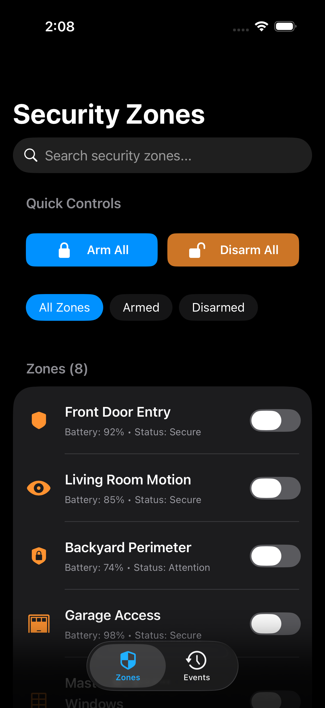
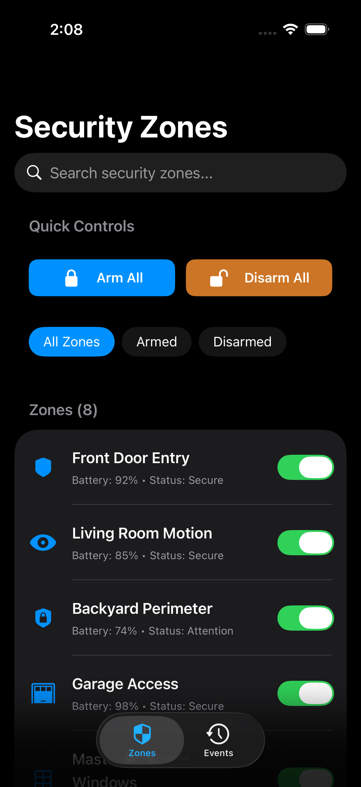
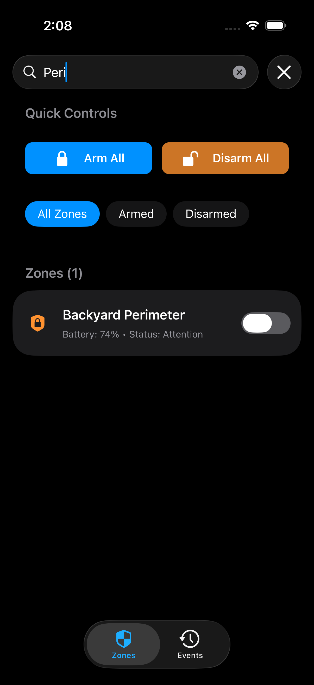
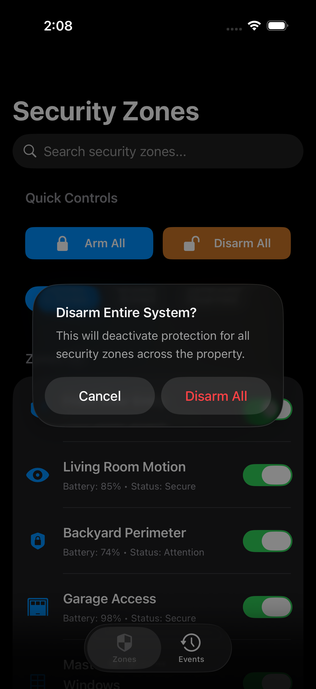
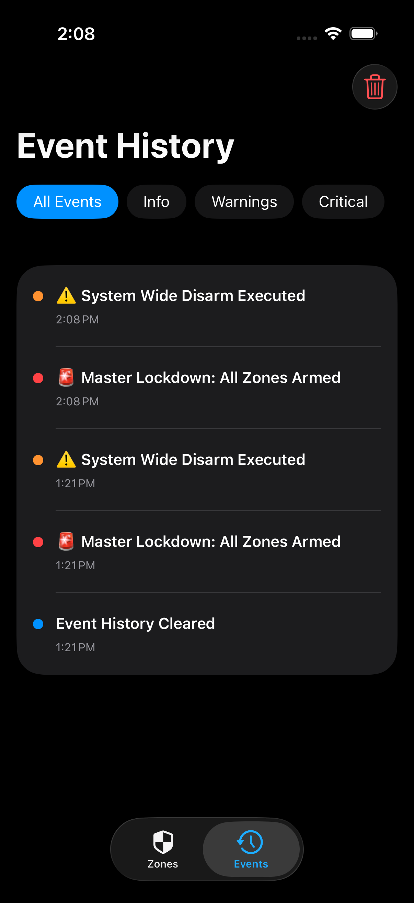
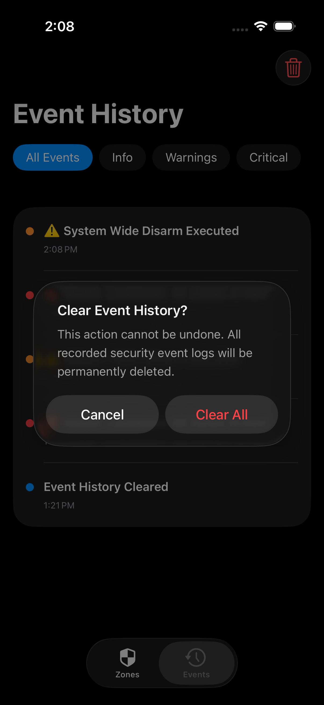

# 🛡️ Home Security Panel

An elegant, lightweight iOS application built with **SwiftUI** and modern **Swift Concurrency**, designed to track residential security zones and historical event logs in real time.

---

## 🚀 Key Features

* **Zone Dashboard:** Real-time monitoring of designated security zones with battery diagnostics, sensor status, and reactive arm/disarm toggles.
* **Search & Filter Zones:** Search zones by name and filter by state (All / Armed / Disarmed).
* **Master Lockdown Controls:** One-tap "Arm All" and confirmation-gated "Disarm All" across every zone.
* **Event History Screen:** Chronological log tracking system events with color-coded severity levels (info / warning / critical), severity filtering, and pull-to-refresh asynchronous simulation.
* **Clear History:** Toolbar action to wipe all event logs (with confirmation).
* **Haptic Feedback:** Tactile feedback on zone toggles and master actions via `UIImpactFeedbackGenerator`.
* **Modular Tab Layout:** Clean navigation split cleanly between zones and historical alerts.
* **Local Persistence:** Zones and events are persisted across app launches using `UserDefaults` (JSON-encoded `Codable` models).
* **Reactive State:** Single source of truth via an `@Observable` `SecurityManager` injected through the SwiftUI environment.

---

## 🏗️ Architecture & Design Patterns

* **MVVM Design Pattern:** Clean separation between pure data models (`SecurityZoneModel`, `SecurityEventModel`), state handlers (`SecurityManager`), and declarative SwiftUI views.
* **Swift Concurrency:** Utilizes structured concurrency (`async/await`, `Task.sleep`) for asynchronous data refresh simulations.
* **Declarative UI:** Built entirely using modern SwiftUI (`NavigationStack`, `TabView`, `@State` bindings, `.refreshable`, `.searchable`, `.alert`, toolbars).
* **Haptics:** Uses `UIKit`'s `UIImpactFeedbackGenerator` for tactile feedback on interactions.
* **Observation Framework:** Uses the `@Observable` macro (iOS 17+) for fine-grained, automatic view updates without manual `ObservableObject`/`@Published` boilerplate.
* **Persistence Layer:** `didSet` observers on published collections encode to `UserDefaults` on every mutation; `init` hydrates from storage or falls back to mock data.

---

## 📂 Project Structure

```text
HomeSecurityPanel/
├── App/
│   └── HomeSecurityPanelApp.swift        # @main entry point → MainTabView
├── Models/
│   ├── SecurityZoneModel.swift           # Zone data model (id, name, isArmed, batteryLevel, sensorStatus, iconName)
│   ├── SecurityEventModel.swift           # Event data model (id, title, timestamp, severity w/ color)
│   └── SecurityManager.swift             # @Observable state holder + persistence + toggle logic
├── Views/
│   ├── MainTabView.swift                 # TabView (Zones / Events) + injects SecurityManager
│   ├── Dashboard/
│   │   └── ZoneListView.swift            # List of zones with arm/disarm Toggle
│   └── Events/
│       └── EventHistoryView.swift        # Chronological event log + pull-to-refresh
└── Resources/
    └── Assets.xcassets                   # App icon, accent color
```

---

## 🧩 Data Models

### `SecurityZoneModel`
| Property | Type | Description |
|---|---|---|
| `id` | `UUID` | Unique identifier |
| `name` | `String` | Human-readable zone name |
| `isArmed` | `Bool` | Whether the zone is currently armed |
| `batteryLevel` | `Int` | Sensor battery percentage (0–100) |
| `sensorStatus` | `String` | Status text (e.g. "Secure", "Attention") |
| `iconName` | `String` | SF Symbol name for the zone icon |

### `SecurityEventModel`
| Property | Type | Description |
|---|---|---|
| `id` | `UUID` | Unique identifier |
| `title` | `String` | Event description |
| `timestamp` | `String` | Human-readable time string |
| `severity` | `EventSeverity` | `.info` (blue), `.warning` (orange), `.critical` (red) |

---

## 🔄 State & Event Flow

1. `MainTabView` creates a single `@State SecurityManager` and injects it via `.environment(...)`.
2. `ZoneListView` reads `securityManager.zones`, applies search + filter, and renders each zone row.
   - "Arm All" calls `securityManager.setAllZones(armed: true)` directly.
   - "Disarm All" presents a confirmation alert, then calls `securityManager.setAllZones(armed: false)`.
3. Toggling a zone calls `securityManager.toggleZone(_:)`, which:
   - Flips `isArmed` for the matching zone.
   - Fires haptic feedback (medium if arming, light if disarming).
   - Stamps the current time.
   - Prepends a new `SecurityEventModel` (severity `.info` if armed, `.warning` if disarmed).
   - Triggers `didSet` persistence for both collections.
4. `setAllZones(armed:)` updates every zone, fires a heavy haptic, and logs a master event (severity `.critical` if arming all, `.warning` if disarming all).
5. `EventHistoryView` renders filtered `securityManager.events` (newest first) with color-coded severity dots; severity chips filter by level.
6. Toolbar trash button calls `securityManager.clearHistory()`, which wipes logs and re-inserts a single "Event History Cleared" info event (with confirmation alert).
7. Pull-to-refresh invokes `fetchNewEvents()`, which simulates an async fetch via `Task.sleep`.

---

## ⚙️ Requirements

* **Xcode:** 26.0 or later (project uses deployment target 26.2)
* **iOS:** 26.2+ (iPhone & iPad — `TARGETED_DEVICE_FAMILY = "1,2"`)
* **Swift:** 5.0
* **No third-party dependencies** — uses only first-party frameworks (SwiftUI, Foundation, Observation, UIKit).

---

## 🛠️ Build & Run

1. Clone the repository:
   ```bash
   git clone https://github.com/arjunpkumar/IBTP1203-Home-Security-Panel.git
   cd IBTP1203-Home-Security-Panel/HomeSecurityPanel
   ```
2. Open the project in Xcode:
   ```bash
   open HomeSecurityPanel.xcodeproj
   ```
3. Select a simulator (e.g. iPhone 17) or a connected device.
4. Build & run with `⌘R`.

Or build from the command line:
```bash
xcodebuild -project HomeSecurityPanel.xcodeproj \
           -scheme HomeSecurityPanel \
           -destination 'platform=iOS Simulator,name=iPhone 17' \
           build
```

---

## 🧪 Testing

No unit/UI tests are currently included. To add tests, create a test target in Xcode and cover:
* `SecurityManager.toggleZone(_:)` state + event creation + haptic path.
* `SecurityManager.setAllZones(armed:)` bulk update + master event.
* `SecurityManager.clearHistory()` wipe + reset event.
* `didSet` persistence round-trip via `UserDefaults`.
* `SecurityEventModel.EventSeverity.color` mapping.
* Zone filtering logic (`ZoneFilter` / `filteredZones`) and severity filtering (`filteredEvents`).

---

## 📝 Known Limitations

* `fetchNewEvents()` only simulates latency (`Task.sleep`) and does not generate new events.
* Duplicate `import SwiftUI` statements were removed; `SecurityManager` now imports `UIKit` for haptics.
* `SecurityEventModel` and `SecurityManager` could reduce SwiftUI dependency further (only `Color`/`@Observable` needed).
* No remote backend or push notifications — all data is local/mock.
* Default mock dataset now contains 8 security zones.

---

## 📸 Screenshots

| Security Zones — Landing | Security Zones — All Armed |
|---|---|
|  |  |

| Security Zones — Search | Security Zones — Disarm Warning |
|---|---|
|  |  |

| Event History | Event History — Cleared |
|---|---|
|  |  |

---

## 📄 License

No license file is currently specified. Please contact the repository owner for usage terms.